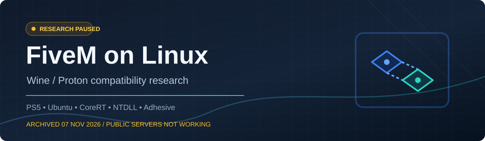

  
  <h1>مشروع FiveM على Linux — الأرشيف التقني</h1>
  
<strong>بحث مستقل في توافق Wine وProton على أوبنتو فوق PS5</strong>

  

    <a href="README.md">English</a> ·
    <a href="docs/INDEX.md">فهرس التوثيق</a> ·
    <a href="docs/EXPERIMENTS.md">التجارب</a> ·
    <a href="docs/FINDINGS.md">النتائج التقنية</a> ·
    <a href="https://github.com/feraskozx1-byte/Fivem-linux/issues/1">المشكلة النهائية</a>
  

> [!IMPORTANT]
> **المشروع متوقف منذ 7 نوفمبر 2026.** هذا أرشيف للبحث والتجارب، **وليس إصدارًا جاهزًا من FiveM على لينكس**. لم ننجح في تشغيل الحماية الرسمية Adhesive أو دخول السيرفرات العامة المحمية، ولا نوفر أدوات لتجاوز الحماية.

## نظرة سريعة

| العنصر | النتيجة |
| :-- | :-- |
| **الهدف** | تشغيل FiveM GTA V Legacy على Wine/Proton مع الحماية الأصلية وتذاكر الاتصال الرسمية |
| **الجهاز** | PS5 معدّل، إصدار 13.60، أوبنتو يعمل بسلسلة إقلاع Byepervisor + SonicISO |
| **مدة العمل** | نحو 10 أيام، وتوقفنا يوم 7 نوفمبر 2026 |
| **تشغيل العميل** | **نجاح جزئي:** وصلنا إلى Rockstar Launcher و`b3258_GameProc` و`pre-gameload` |
| **Adhesive الرسمية** | **فشل:** الخطأ `998` والانهيار `0xC0000005` عند `D9FEC5` |
| **السيرفرات العامة** | **لم تعمل**؛ لم نثبت عمل المصادقة والموارد المحمية |
| **أرشيف الأدلة** | رُفع **179 ملفًا** من الملفات النصية والأكواد والـPatches في آخر دفعة |

## أقسام المشروع

| القسم | المحتوى |
| :-- | :-- |
| 🗂️ [الفهرس الرئيسي](docs/INDEX.md) | كل صفحات المشروع وروابط الانتقال |
| 🗓️ [التسلسل الزمني](docs/TIMELINE.md) | كيف بدأنا، وش جربنا، ومتى توقفنا |
| 🧪 [جميع التجارب](docs/EXPERIMENTS.md) | مجلدات Ghidra وCoreRT وAdhesive وTLS وNTDLL |
| 🔬 [نتائج التحليل](docs/FINDINGS.md) | التفاصيل الفنية وما الذي أثبتناه فعلًا |
| 📊 [جدول الاختبارات](docs/TEST_MATRIX.md) | الاختبارات الناجحة والفاشلة وغير المحسومة |
| ⛔ [المشاكل المتبقية](docs/BLOCKERS.md) | العائق النهائي وسبب التوقف |
| 💾 [ملفات العمل الأصلية](local-evidence/README.md) | روابط الأكواد والتعديلات التي رُفعت |
| ❓ [الأسئلة الشائعة](docs/FAQ.md) | هل FiveM تعمل؟ وهل نجحت الحماية؟ |
| 🛠️ [تاريخ البناء](docs/BUILD.md) | إصدارات CoreRT وتجارب GitHub Actions |
| 🛡️ [الخصوصية](docs/PRIVACY.md) | الملفات التي تعمدنا عدم نشرها |

## ماذا حققنا؟

**1. تشغيل أجزاء من FiveM:** بنينا نسخًا تجريبية اعتمادًا على [PR #4050](https://github.com/citizenfx/fivem/pull/4050) وجرّبنا تعديلات `CoreRT.dll` حتى وصل العميل إلى مراحل التشغيل السابقة للتحميل الكامل.

**2. تحديد انهيار Adhesive:** عند تهيئة `Adhesive 1.0.0.24769` ظهر `ERROR_NOACCESS (998)` مع `0xC0000005` عند `adhesive+0xD9FEC5`؛ انتقل العميل إلى `sticky`، وهذا **لا يكفي للسيرفرات المحمية**.

**3. تحليل جدول NTDLL:** نسخة Wine المختبرة عندها 1468 اسم دالة مصدّرة، ومقارنة Windows المسجلة أظهرت 2457. لاحظنا استمرار مؤشر البحث خارج النطاق حتى 1477، لكن **لم نحدد اسم الدالة المطلوبة أو السبب المؤكد**.

**4. اختبار تصحيح في Wine:** أثبتنا اختلافًا في نتيجة واجهة عامة تتعلق بـTLS، وصححناه في نسخة تجريبية معزولة. **لم يصلح انهيار Adhesive**، ولذلك لم نعتمده حلًا نهائيًا.

## نقطة التوقف

**الهدف الأساسي لم يتحقق:** تشغيل FiveM مع الحماية الرسمية والدخول للسيرفرات العامة على Linux. اكتشفنا أجزاء مهمة من سلسلة الأعطال واحتفظنا بنتائج التجارب، لكننا لم نثبت إصلاحًا يعمل من البداية إلى النهاية.

تم استيراد ملفات النصوص والأكواد في [`local-evidence/`](local-evidence/README.md). أما ملفات اللعبة الأصلية وDLL الحماية والنسخ التنفيذية الكبيرة وبيانات الحسابات فلم تُنشر.

## المصادر وحقوق الآخرين

المشروع مستقل وغير تابع لـCfx.re أو Rockstar. الأكواد الخارجية وملفات Wine وFiveM تحت تراخيص أصحابها. اقرأ [المصادر](docs/SOURCE_AND_CREDITS.md)، و[حقوق وتراخيص الأطراف الأخرى](THIRD_PARTY_NOTICES.md)، و[تقييم النشر للعامة](docs/PUBLICATION_AUDIT.md)، و[الأمان](SECURITY.md).

---

أرشيف هندسي محفوظ للرجوع إليه — وليس إعلانًا عن نجاح تشغيل السيرفرات العامة.

