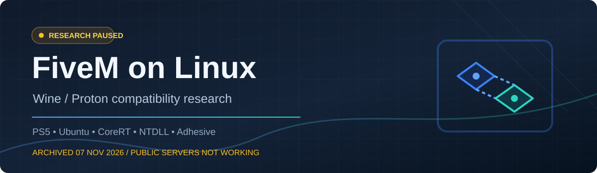

<div align="center">
  
  <h1>FiveM on Linux · Research Archive</h1>
  <p><strong>Independent Wine / Proton compatibility research · PlayStation 5 + Ubuntu</strong></p>
  <p>
    <a href="README.ar.md">🇸🇦 اقرأ بالعربية</a> ·
    <a href="docs/INDEX.md">Documentation</a> ·
    <a href="docs/EXPERIMENTS.md">Experiments</a> ·
    <a href="docs/FINDINGS.md">Technical Findings</a> ·
    <a href="https://github.com/feraskozx1-byte/Fivem-linux/issues/1">Open Blocker</a>
  </p>
</div>

> [!IMPORTANT]
> **RESEARCH PAUSED · 7 NOVEMBER 2026.** This is a research archive, **not a FiveM Linux release**. Official Adhesive initialization, protected public-server access and authentication **did not work**. No anti-cheat bypass or modified proprietary protection library is distributed.

## At a glance

| Research scope | Recorded outcome |
| :-- | :-- |
| **Goal** | Run FiveM GTA V Legacy through Wine/Proton with the **original** protection and valid public-server authentication |
| **Host** | Ubuntu on a jailbroken PS5 (firmware 13.60), using Byepervisor + SonicISO boot chain |
| **Research period** | Approximately **10 days**, paused **2026-11-07** |
| **Client startup** | **Partial success** — Rockstar Launcher, `b3258_GameProc` and `pre-gameload` observed |
| **Official Adhesive** | **Failed** — `ERROR_NOACCESS (998)`, `0xC0000005` at `adhesive+0xD9FEC5` |
| **Public protected servers** | **Not working**; legitimate `cfxTicket2` and protected `ci://` behavior not verified |
| **Local evidence** | **179 files** imported on 2026-11-07 (patches, notes, source probes, experimental fixtures) |

## Explore the project

| Start here | Investigate |
| :-- | :-- |
| 🗂️ **[Documentation hub](docs/INDEX.md)** — all chapters and guides | 🧪 **[Experiment directory](docs/EXPERIMENTS.md)** — original source, patches and probes |
| 🗓️ **[Project timeline](docs/TIMELINE.md)** — steps from first tests to pause | 🔬 **[Technical findings](docs/FINDINGS.md)** — carefully separated observations and hypotheses |
| 📊 **[Test matrix](docs/TEST_MATRIX.md)** — what passed and failed | ⛔ **[Unresolved blockers](docs/BLOCKERS.md)** — why we stopped |
| ❓ **[FAQ](docs/FAQ.md)** — common misunderstandings | 💻 **[Original evidence](local-evidence/README.md)** — raw research materials and provenance |
| 🛠️ **[Build notes](docs/BUILD.md)** — CoreRT and CI history | 🛡️ **[Privacy and source policy](docs/PRIVACY.md)** — what was deliberately excluded |

## Main findings

### 01 · A real FiveM startup milestone

Changes based on [citizenfx/fivem PR #4050](https://github.com/citizenfx/fivem/pull/4050) and targeted local CoreRT experiments enabled **parts** of the Windows FiveM client to initialize under Proton-CachyOS/Wine. The observed path included Rockstar Launcher, `b3258_GameProc` and `pre-gameload`. These stages did **not** prove the protected online path was available.

### 02 · Original Adhesive failed during initialization

The official `Adhesive 1.0.0.24769` binary failed at `DLL_PROCESS_ATTACH` under the tested Wine environment; the client logged error `998` and fell back to `sticky`. The observed access violation was `0xC0000005` at RVA `D9FEC5`. **Sticky fallback was not a solution for protected public servers.**

### 03 · NTDLL export-table boundary investigated

The tested Wine `ntdll.dll` had `NumberOfNames = 1468`; the recorded Windows Server 2022 reference had `2457`. In the failing trace, the name-table index went out of range at `1468` and the crash was observed at `1477`. The **specific requested export and the missing termination contract remain unidentified**. Export-count disparity alone is not proof of the underlying cause.

### 04 · An isolated Wine TLS fix did not fix Adhesive

Independent public-loader fixtures exposed a `DisableThreadLibraryCalls`/static-TLS return difference. A reversible experimental prototype corrected that observable behavior, but **the Adhesive crash, iterator behavior and error 998 remained unchanged**. We documented this negative result instead of declaring an unsupported fix.

[Read the complete findings →](docs/FINDINGS.md)

## Research map

```text
FiveM-PR4050-Test (original PS5 Ubuntu workspace; not fully redistributed)
  ├── Original-PR4050-Source/   upstream-derived code and local changes
  ├── Run-CoreRT-Test/         experimental client runtime (NOT uploaded)
  ├── Run-Adhesive-Test/       official DLL test runtime (NOT uploaded)
  └── Diagnostics/            trace probes, analysis, fixtures and reports
           │
           └── local-evidence/Diagnostics/   selected reviewed TEXT/SOURCE copies
               ├── 2026-11-05-Compatibility/
               ├── 2026-11-05-Adhesive-Ghidra/
               ├── 2026-11-05-Adhesive-RCA/
               ├── 2026-11-07-TLS-Causality/
               └── 2026-11-07-Export-Bounds/
```

The full map, including all imported experiment directories, is in [EXPERIMENTS.md](docs/EXPERIMENTS.md).

## Current status

The research stopped after approximately ten days because the **central outcome**—joining protected public FiveM servers with original protection and legitimate authentication—was not achieved. The exact cause of the Adhesive initialization failure was still unknown.

**No prebuilt working client, authentication workaround, security-disabling instructions or proprietary game files are provided.** Uploaded source/patch text is historical evidence and has not been verified as a reusable standalone build.

## Provenance and credits

This project draws on the upstream [citizenfx/fivem](https://github.com/citizenfx/fivem), community work on [PR #4050](https://github.com/citizenfx/fivem/pull/4050), and an independent series of tests run on the PS5 Ubuntu host. Existing Windows CI notes are archived in [archive/build-workflow.yml](archive/build-workflow.yml); [the build repository](https://github.com/feraskozx1-byte/fivem-pr4050-build) remains separate.

FiveM, GTA V, Wine, Proton and their respective authors retain their rights and licenses. See [source credits](docs/SOURCE_AND_CREDITS.md), [third-party license notices](THIRD_PARTY_NOTICES.md), [publication audit](docs/PUBLICATION_AUDIT.md), [security](SECURITY.md), [contributing](CONTRIBUTING.md), and [changelog](CHANGELOG.md).

---

<div align="center">
  <sub>Historical compatibility research · Not affiliated with Cfx.re / Rockstar Games · No claim of working protected public-server support</sub>
</div>
